# MISSIONWISE AI

**Space Mission Engineering Intelligence Platform** (AVISHKAR 2K26 — Problem #10: Space Mission Lessons-Learned Assistant with Cited Answers)  
Team: **ProtoGuys**

> **Safety Notice:** MISSIONWISE is a knowledge-support tool, not a certifier of spacecraft safety. All findings must be verified against the cited primary engineering reports.

---

## System Architecture

```mermaid
flowchart LR
  User["Engineer / Analyst (Text or Voice)"] --> Frontend["React + TypeScript Console\n(React Flow, react-pdf, Zustand)"]
  Frontend -->|POST /api/chat & WS /api/voice/stream| API["FastAPI API Layer\n(JWT RBAC, Rate Limiter, Audit Logs)"]
  API --> Rewriter["Follow-up Query Rewriter\n(Conversation Memory)"]
  Rewriter --> STAIR["STAIR SectionSelector\nL1 BM25-ToC | L2 ToC->Leaf | L3 LoRA"]
  STAIR --> Hybrid["Hybrid Retrieval\n(pgvector HNSW + tsvector FTS + RRF)"]
  Hybrid --> Rerank["Cross-Encoder Reranker\n(bge-reranker-base) + Sufficiency Gate"]
  Rerank -->|Low Evidence| Abstain["Exact Abstention Message"]
  Rerank -->|Sufficient Evidence| LLM["Provider-Agnostic LLMClient\n(Untrusted Delimiting + Pydantic JSON)"]
  LLM --> Validator["Pre-Response Citation Validator\n(DB Chunk + Page + Quote Check)"]
  Validator --> Output["Cited Claims + Deterministic Confidence\n+ Failure Chains + KG + PDF BBox"]
  API --> DB[("PostgreSQL 16 + pgvector\nDocuments, Sections, Chunks, KG, Logs")]
```



---

## Phase 1 Capabilities

- **PostgreSQL 16 + pgvector Schema (Alembic):** Full schema covering auth/audit, documents & versions, hierarchical `document_sections`, `document_chunks` with PDF bounding boxes and `tsvector` lexical search, `document_embeddings` (HNSW), `retrieval_logs`, `conversations`/`messages`/`citations`, and Phase 2+ failure chain & engineering knowledge graph tables.
- **PDF Ingestion Pipeline:**
  - Mandatory `source_url` and `licence` validation (public reports only).
  - Magic-byte (`%PDF-`), MIME, size, and SHA-256 hash-based deduplication.
  - PyMuPDF (`fitz`) text, metadata, `get_toc()` + font-size heading heuristic fallback, and exact bounding-box extraction (`[x0, y0, x1, y1]`).
  - Automatic Tesseract OCR fallback for scanned/low-text pages with mean word confidence and alphanumeric quality checks.
  - Structure- and page-preserving semantic chunking with merged bbox retention.
- **Hybrid Retrieval & Grounded RAG:**
  - `BAAI/bge-small-en-v1.5` embeddings (configurable) + pgvector HNSW dense search + BM25/FTS lexical search + Reciprocal Rank Fusion (RRF) + Cross-Encoder Reranker (`BAAI/bge-reranker-base`).
  - Provider-agnostic `LLMClient` (Gemini default via `GEMINI_API_KEY`) with prompt-injection delimiting and Pydantic JSON validation + retry.
  - Pre-response **Citation Validator** checking chunk/document/page resolution and quote/lexical support before returning answers.
  - **Deterministic Retrieval Confidence** (`Strong`, `Partial`, `Conflicting`, `Insufficient`, `None`) — never LLM self-reported.
  - **Exact Abstention Policy:** low-evidence or ungrounded queries return `"Not found in the available mission reports. More supporting documentation is required."`
- **Frontend Console & Citation Viewer:**
  - Instrument-grade mission-control UI built from `frontend/src/styles/design-tokens.ts`.
  - Resizable split-pane Research Assistant + PDF Citation Viewer (`react-pdf`) that opens directly at the cited page and overlays translucent amber highlights via chunk bounding boxes.

---

## Honest STAIR Implementation Status

MISSIONWISE ships STAIR-style structure-aware retrieval incrementally and labels every level honestly:
- **L1 (Active):** Hierarchical document section index (`document_sections` with `is_leaf` and 3-tier ToC extraction: PDF outline -> font/numbering heuristics -> LLM repair) + `BM25ToCSectionSelector` baseline.
- **L2 (Active — Phase 2):** ToC-aware query-to-leaf selection (`STAIRInspiredSectionSelector`) returning validated leaf section IDs via `POST /api/stair/retrieve`, with Document Explorer ToC tree highlighting.
- **L3 / L4 (Optional GPU Training — Phase 2):** `scripts/generate_training_data.py` + `scripts/train_stair.py` (LoRA fine-tuning + constrained leaf-ID decoding for free Colab/Kaggle GPUs; see [docs/stair_training.md](docs/stair_training.md)), wired behind `FineTunedSTAIRSectionSelector`.

## Evaluation (Phase 2)
Run the retrieval benchmark across `data/evaluation/questions.jsonl` (42 questions including 10 unanswerable):
```bash
python scripts/evaluate_retrieval.py --questions data/evaluation/questions.jsonl
```
Results are saved to `data/evaluation/retrieval_results.json` and served by `GET /api/eval/results` to the Evaluation page. Until executed, the UI displays `"Not yet evaluated"`.

## Voice Assistant (Phase 3)
- **Single Shared Pipeline:** `WS /api/voice/stream`, `POST /api/voice/transcribe`, and `POST /api/voice/synthesize` route through the exact same `RAGService` + `CitationValidator` as `POST /api/chat`.
- **Aerospace-Biased STT & Fallbacks:** Server `faster-whisper` uses an aerospace vocabulary prompt (`Small Forces`, `Newton-seconds`, `Apollo 13`, etc.); falls back to browser Web Speech API (`SpeechRecognition`) and `window.speechSynthesis` if server STT/TTS models are unavailable.
- **Follow-up Memory & Spoken Style:** Resolves follow-ups (`"what was the initial issue?"`, `"explain simpler"`) into standalone questions and outputs concise spoken briefings with identical verified claims, live captions, PTT/hands-free modes, and barge-in/interrupt support.

## Failure Chain Analyzer (Phase 4)
- **Zero Hardcoded Chains:** `POST /api/failures/reconstruct` uses the shared `HybridRetriever` to pull investigation/anomaly/findings chunks, extracts structured `failure_events` and `failure_relationships` (`verification_status=pending`), and runs `evidence_validator` to promote records to `verified` only when the quote is supported in the stored chunk and both endpoints are verified.
- **Chronology vs Causality:** Separates timeline ordering (`event_order`, `preceded_by`) from causal edges (`caused_by`, `contributed_to`, `associated_with`, `reported_as`) in the interactive React Flow canvas (`GET /api/failures/{id}/events`, `/relationships`), rendering unverified edges dashed with `"Unverified"` badges and offering one-click PDF jump + voice/text follow-up.

## Similar Past Failures & Knowledge Graph (Phase 5)
- **Incident Index (`mission_incidents`):** Extracted via `scripts/index_incidents_kg.py` or `POST /api/kg/index` with subsystem, root cause, consequence, corrective action, pgvector embedding, and `tsvector` + chunk provenance.
- **Similar Failures (`POST /api/similar-failures/search`):** Extracts subsystems/mechanisms from the problem description, runs dense + BM25 + cross-encoder reranking with a subsystem/mechanism match boost, and returns transparent relevance breakdown + `"Reconstruct chain"` jump.
- **Knowledge Graph Explorer (`GET /api/kg/graph`, `POST /api/kg/query`):** React Flow explorer over `mission_entities` and `mission_entity_relations` (`Mission > Subsystem > Component > Anomaly > Root Cause > Corrective Action`) supporting cited multi-hop queries.

---

## Quickstart

### 1. Configure Environment
```bash
cp .env.example .env
# Add your GEMINI_API_KEY to .env
```

### 2. Download & Verify 3 Public Seed Reports
```bash
python scripts/download_seed_reports.py
```

### 3. Start Stack via Docker Compose
```bash
docker compose up --build -d
```

### 4. Seed the Knowledge Base
```bash
docker compose exec backend python /scripts/ingest_documents.py --manifest /data/raw_documents/manifest.json
```

### 5. Access Services
- Frontend UI: `http://localhost:5173`
- Backend API & Swagger: `http://localhost:8001/docs` (container port `8000`)
- Health Check: `http://localhost:8001/api/health`

### 6. Demo Mode & Seeded Credentials (Phase 6)
- Toggle **Demo Mode** in the top console header to open the 6-step guided walkthrough (`Step 01` STAIR query -> `Step 02` PDF bbox viewer -> `Step 03` Similar Failures -> `Step 04` Failure Chain -> `Step 05` Knowledge Graph -> `Step 06` Evaluation & Admin).
- Click **Pre-Warm Cache** (or call `POST /api/demo/prewarm`) to pre-compute and persist DB-verified responses in `data/demo/demo_cache.json`. Every cached response validates `chunk_id` resolution against PostgreSQL before being served.
- **Seeded Dev Accounts** (change passwords in `.env` before non-local use):
  - Admin (`ADM-08`): `admin@missionwise.local` / `Admin!Mission2026`
  - Engineer: `engineer@missionwise.local` / `Engineer!Mission2026`

### 7. Security & Hardening (Phase 6)
- **JWT Authentication & RBAC:** HS256 JWT tokens + PBKDF2-HMAC-SHA256 salted password hashes protecting `GET/PATCH /api/admin/*` (`admin` role required).
- **Rate Limiting:** Sliding-window per-client throttling across `/api/*` and stricter throttling on `/api/chat` returning structured `429 RATE_LIMIT_EXCEEDED`.
- **Upload Hardening & Prompt-Injection Defense:** Rejects invalid extensions/MIME types, missing `%PDF-` magic bytes, malformed cross-reference tables, oversized page counts, path traversal filenames, and active PDF actions (`/JavaScript`, `/JS`, `/OpenAction`, `/Launch`); strips injection directives from archival text, encloses retrieved excerpts in untrusted delimiters, and enforces pre-response citation validation.
- **Audit & Model/Prompt Telemetry:** All uploads, ingests, chat queries, failure reconstructions, KG runs, and role/settings changes log to `audit_logs` and `retrieval_logs` (including `embedding_model`, `reranker_model`, `llm_model`, `prompt_version`).

### 8. Run Tests (Backend + Playwright E2E)
```bash
# Backend unit & integration tests (includes malicious PDF fixture)
backend\.venv\Scripts\python.exe -m pytest backend/tests -v

# Frontend TypeScript & Vite production build
npm --prefix frontend run build

# End-to-end Playwright smoke suite against running stack
npx --prefix frontend playwright test
```

---

## Honest Limitations

- **Corpus Scope:** Currently seeded with 3 public NASA mishap reports (`NASA-MCO-1999`, `NASA-A13-1970`, `NASA-MPL-2000`); queries outside indexed documents intentionally trigger exact abstention rather than extrapolating. Additional public NASA/ISRO/ESA PDFs can be added via `POST /api/documents/upload` or `scripts/ingest_documents.py`.
- **STAIR L3/L4 LoRA Adapter:** `STAIRInspiredSectionSelector` (L2 ToC-to-leaf selection) runs out of the box. Fine-tuned L3/L4 constrained decoding requires running `scripts/train_stair.py` on a GPU and configuring `STAIR_LORA_ADAPTER_PATH`; otherwise `FineTunedSTAIRSectionSelector` gracefully falls back to L2.
- **Voice STT/TTS:** Uses `faster-whisper` / Piper on the server when binaries/models are present, falling back to browser Web Speech API / `SpeechSynthesis` in unsupported or CPU-constrained environments.
- **Safety Governance:** MISSIONWISE AI is an engineering lessons-learned research assistant and **must not** be used as a flight-readiness or spacecraft safety certification authority.
